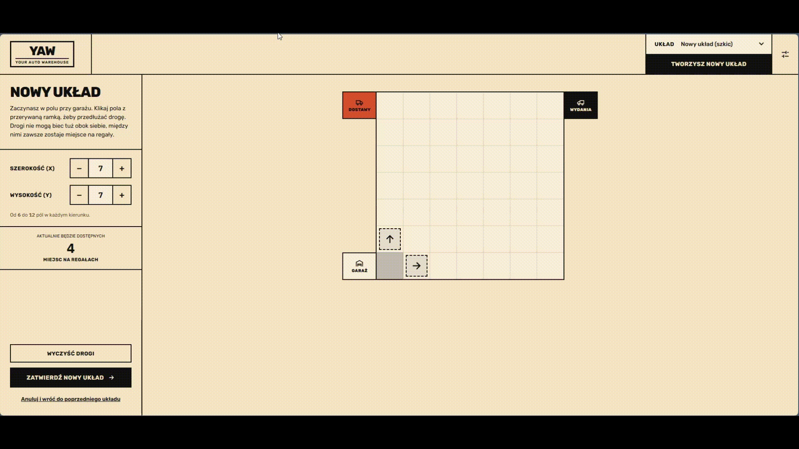

# YourAutoWarehouse – Frontend

**Angular client for [YourAutoWarehouse](https://github.com/swiczka/YourAutoWarehouse)**, a simulated automated warehouse. Design a warehouse on a grid, place orders, and watch forklifts move packages live.

| Layout editor |
|---|
|  |

| Simulation |
|---|
|  |


---

## Features

- **Grid layout editor** – draw roads and set allowed driving directions per cell. Shelves are placed automatically next to roads. Save multiple layouts and switch between them.
- **Interactive zones** – delivery zone for incoming packages and sending zone showing dispatched ones.
- **Orders** – create inbound and outbound orders and track the status of every package.
- **Live forklifts** – positions arrive over WebSocket (STOMP) and are rendered on the grid. Each forklift has its own color.
- **Package details** – click a package to see its status and location.

## Tech stack

- **Angular 22** (standalone components), TypeScript*, SCSS
- **Angular Material**
- **RxJS** and **@stomp/rx-stomp** for reactive WebSocket subscriptions
- HTTP interceptor adding a per-browser `X-Guest-Id`, generated once and kept in `localStorage`

## Getting started

**Requirements:** Node.js 20+ and the [backend](https://github.com/swiczka/YourAutoWarehouse) running on `localhost:8080` (`docker compose up`).

```bash
git clone https://github.com/swiczka/front-YourAutoWarehouse.git
cd front-YourAutoWarehouse
npm install
npm start
```

Open http://localhost:4200. In development, requests to `/api` are proxied to the gateway on port 8080 (`src/proxy.conf.json`), and the WebSocket connects to `ws://127.0.0.1:8080/ws`.

## Project structure

```
src/app/
├── mainarea/        # warehouse grid: view and edit modes (gridcell, editgridcell)
├── components/      # forklift, delivery-zone, sending-zone, order-panel,
│                    # orders-view, order-packages, package-popup, header
├── services/        # grid, edit-grid, forklift and package state
├── api-services/    # REST clients for the backend
├── stomp/           # RxStomp configuration and subscriptions
├── api/             # HTTP interceptor (X-Guest-Id)
├── dto/ events/     # types shared with the backend
└── config/          # e.g. forklift colors
```

## Roadmap

- [ ] Move the WebSocket URL to `environment.ts`
- [ ] Dockerfile and integration with the backend's `docker compose`
- [ ] Component tests for the editor and order flow

**Author:** Damian Świeca · [GitHub](https://github.com/swiczka)
